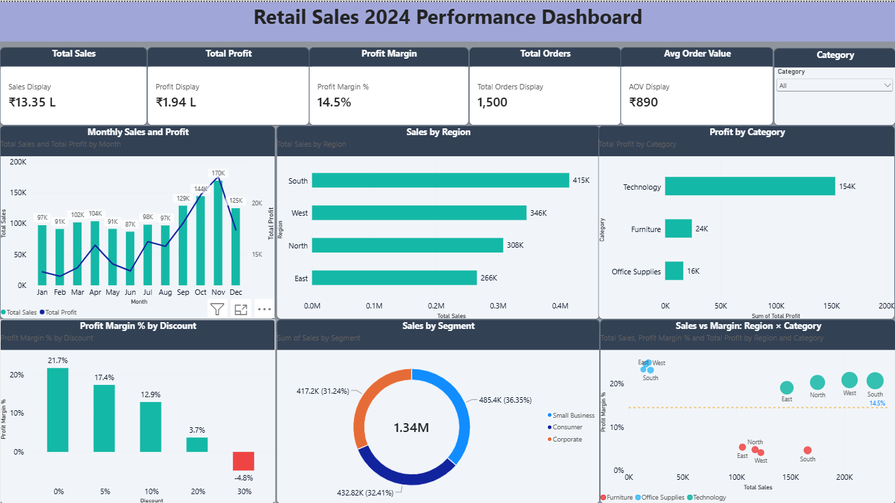

# Retail Sales Performance Analysis 2024

An end-to-end analysis of 1,500 retail orders using Excel, SQL and Power BI.

## Objective
Understand sales and profit across regions, categories, segments and discount levels, and find where profit is being lost.

## Tools used
- **Excel:** data cleaning, quality checks, helper columns, pivot tables
- **SQL (MySQL):** table design, data quality checks, analysis queries
- **Power BI:** DAX measures, KPI cards and an interactive dashboard

## Key results
| Metric | Value |
|---|---|
| Total sales | ₹13.35 lakh |
| Total profit | ₹1.94 lakh |
| Profit margin | 14.5% |
| Orders | 1,500 |
| Average order value | ₹890 |

## Key insights
1. **Discounts erase profit.** Margin falls from 21.7% at no discount to **-4.8% at a 30% discount**.
2. **Furniture earns very little.** Its margin is about 4.7%, against 20% or more for Technology and Office Supplies.
3. **Technology drives profit,** contributing about ₹154K.
4. **South is the top region** by sales, at about ₹415K.

## Recommendation
Review or cap deep discounts, and revisit Furniture pricing.

## Data quality
Checks for nulls, duplicates, data types, text spacing and logic were done in Excel and SQL. Totals were reconciled across Excel, SQL and Power BI.

## Project files
| Folder | Contents |
|---|---|
| `data/` | Cleaned dataset (CSV) |
| `excel/` | Workbook with the Data Quality Log and pivot tables |
| `sql/` | Table creation, data quality checks and analysis queries |
| `powerbi/` | Dashboard file (.pbix) and PDF export |

## Author
Subapriya Radhakrishnan | Data Analyst

[LinkedIn](https://www.linkedin.com/in/subapriya-radhakrishnan-a72407283/) | [GitHub](https://github.com/Subapriya007) | Subavelkrishnan07@gmail.com
